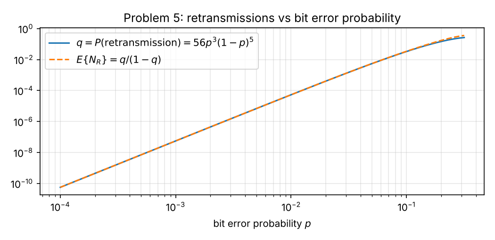

# Week 1 — Step-by-Step Solutions (Tutorial 1)

**Course:** Statistical Signal Processing (L.048.24014, Universität Paderborn, Dr.-Ing. Tanuj Hasija), WiSe 2026/27
**Covers:** Tutorial 1, Problems 1–5
**Checking:** no official solution was available when this was written. Every result is verified by [`python/tutorial1_verify.py`](python/tutorial1_verify.py) (exact fractions, symbolic sums with SymPy, Monte Carlo simulation).

Every step is written out. References like "Concepts §6" point to [`01_Concepts.md`](01_Concepts.md).

---

## Contents

- [Problem 1 — Monty Hall](#problem-1--monty-hall)
- [Problem 2 — Poisson: hits on a website](#problem-2--poisson-hits-on-a-website)
- [Problem 3 — Mean and variance of a Poisson RV](#problem-3--mean-and-variance-of-a-poisson-rv)
- [Problem 4 — Deriving the Binomial distribution](#problem-4--deriving-the-binomial-distribution)
- [Problem 5 — Channel decoder and retransmissions](#problem-5--channel-decoder-and-retransmissions)
- [Summary of results](#summary-of-results)

---

## Problem 1 — Monty Hall

> Three doors: a car behind one, goats behind the other two. You pick door 3. The host, **who knows** where the car is, opens door 1, which has a goat, and offers you door 2. Should you switch?

### Step 1 — State the rules of the game precisely

The answer depends on **how the host chooses**, so we make the standard assumptions explicit:

1. The car is placed uniformly at random: each door has probability $1/3$.
2. The host **always** opens a door that (a) you did not pick and (b) has a goat, and then **always** offers the switch.
3. If both unpicked doors have goats (i.e. your door has the car), the host chooses between them at random, each with probability $1/2$.

### Step 2 — Causes, priors and the observation

Causes (a partition, Concepts §6.1): $C_i$ = "car behind door $i$", $i = 1,2,3$, with priors
$$P(C_1) = P(C_2) = P(C_3) = \tfrac13.$$
Observation: $H_1$ = "host opens door 1" (given that you hold door 3).

### Step 3 — Likelihoods: how probable is "host opens door 1" under each cause?

- $C_1$ (car behind door 1): the host never reveals the car ⇒ $P(H_1\mid C_1) = 0$.
- $C_2$ (car behind door 2): the host cannot open door 3 (yours) nor door 2 (car) ⇒ he **must** open door 1 ⇒ $P(H_1\mid C_2) = 1$.
- $C_3$ (car behind your door 3): doors 1 and 2 both have goats, he picks one at random ⇒ $P(H_1\mid C_3) = \tfrac12$.

### Step 4 — Total probability of the observation

$$P(H_1) = \sum_iP(H_1\mid C_i)P(C_i) = 0\cdot\tfrac13 + 1\cdot\tfrac13 + \tfrac12\cdot\tfrac13 = \tfrac12.$$

### Step 5 — Bayes' rule

$$P(C_2\mid H_1) = \frac{P(H_1\mid C_2)P(C_2)}{P(H_1)} = \frac{1\cdot\frac13}{\frac12} = \frac23,\qquad
P(C_3\mid H_1) = \frac{\frac12\cdot\frac13}{\frac12} = \frac13,\qquad P(C_1\mid H_1) = 0.$$
Check: $0 + \frac23 + \frac13 = 1$. ✓

### Step 6 — Decision

$$\boxed{P(\text{win}\mid\text{switch}) = \tfrac23\quad>\quad P(\text{win}\mid\text{stay}) = \tfrac13}$$
**Yes, you should switch.** It doubles your chance of winning the car. A simulation of 200 000 games gives 0.668 for switching and 0.332 for staying.

### Step 7 — Why the intuition "it's 50/50 now" is wrong

- **Counting argument:** your first pick is correct with probability $1/3$ and stays so: the host can **always** open a goat door, so his action tells you nothing about **your** door. Switching wins exactly when your first pick was wrong, which happens with probability $2/3$.
- **Information argument:** the host's choice is **not random**; it is constrained by where the car is. In case $C_2$ he is forced to open door 1, in case $C_3$ he only does so half the time. Door 1 being opened is therefore twice as likely under $C_2$ as under $C_3$, and the posterior shifts in favour of door 2 (likelihood ratio $1 : \frac12$).
- **Exaggerated version:** with 100 doors, you pick one, the host opens 98 goat doors and leaves one closed. Almost surely the car is behind the door he carefully avoided (probability $99/100$).

### Step 8 — The assumptions matter (connection to SSP)

If the host **did not know** where the car is and opened door 1 at random, which happened to show a goat, then $P(H_1\cap\text{goat}\mid C_2) = P(H_1\cap\text{goat}\mid C_3) = \frac12$, and $P(\text{goat at door 1}\mid C_1) = 0$. Bayes then gives $P(C_2\mid\cdot) = P(C_3\mid\cdot) = \frac12$: switching neither helps nor hurts. **The same observation carries different information depending on the mechanism that produced it.** In signal processing terms: the inference depends on the statistical model of the measurement, not just the measured value — the theme of the whole course.

---

## Problem 2 — Poisson: hits on a website

> Hits in a 5-minute interval ~ Poisson(4). Find $P$(at least one hit), $P$(at least 3 hits) and $P$(no more than 5 hits) between 3:00 and 3:05 pm.

### Step 1 — Set up

$X$ = number of hits between 3:00 and 3:05 pm. This is a 5-minute interval, so $X\sim$ Poisson($\lambda = 4$) (Concepts §10.4):
$$P_X(x) = \frac{4^xe^{-4}}{x!},\qquad x = 0,1,2,\dots$$

### Step 2 — Tabulate the first few probabilities

Start with $P_X(0) = e^{-4}$ and use the ratio $P_X(x) = \frac{\lambda}{x}P_X(x-1)$:

| $x$ | $P_X(x)$ exact | multiple of $e^{-4}$ | numerical |
|---|---|---|---|
| 0 | $e^{-4}$ | 1 | 0.018316 |
| 1 | $4e^{-4}$ | 4 | 0.073263 |
| 2 | $\frac{4^2}{2}e^{-4}$ | 8 | 0.146525 |
| 3 | $\frac{4^3}{6}e^{-4}$ | 32/3 | 0.195367 |
| 4 | $\frac{4^4}{24}e^{-4}$ | 32/3 | 0.195367 |
| 5 | $\frac{4^5}{120}e^{-4}$ | 128/15 | 0.156293 |

### Step 3 — At least one hit

"At least one" is the complement of "none" (Concepts §3.2):
$$P(X\ge1) = 1 - P(X = 0) = 1 - e^{-4}\approx\boxed{0.9817}$$

### Step 4 — At least three hits

The direct sum $\sum_{x=3}^{\infty}$ has infinitely many terms, so use the complement $\lbrace X\le2\rbrace$:
$$P(X\ge3) = 1 - \big[P_X(0) + P_X(1) + P_X(2)\big] = 1 - e^{-4}(1 + 4 + 8) = 1 - 13e^{-4}\approx\boxed{0.7619}$$

### Step 5 — No more than five hits

"No more than 5" means $X\le5$, a finite sum:
$$P(X\le5) = e^{-4}\Big(1 + 4 + 8 + \tfrac{32}{3} + \tfrac{32}{3} + \tfrac{128}{15}\Big) = \tfrac{643}{15}e^{-4}\approx\boxed{0.7851}$$
(Common denominator 15: $15 + 60 + 120 + 160 + 160 + 128 = 643$.)

### Step 6 — Sanity checks

- The mean is 4, so "at least one hit" should be very likely (✓ 98%) and "at most 5" (a bit above the mean) should be well above 1/2 (✓ 79%).
- Simulation of $10^6$ Poisson(4) samples: 0.9819, 0.7618, 0.7852. ✓

---

## Problem 3 — Mean and variance of a Poisson RV

> Obtain the mean and variance of $X\sim$ Poisson($\lambda$).

### Step 1 — The pmf sums to one (needed below)

$$\sum_{x=0}^{\infty}\frac{\lambda^xe^{-\lambda}}{x!} = e^{-\lambda}\sum_{x=0}^{\infty}\frac{\lambda^x}{x!} = e^{-\lambda}e^{\lambda} = 1.$$

### Step 2 — Mean

By definition (Concepts §8.1):
$$E\lbrace X\rbrace = \sum_{x=0}^{\infty}x\frac{\lambda^xe^{-\lambda}}{x!}.$$
- The $x = 0$ term is zero, so start at $x = 1$.
- For $x\ge1$: $\frac{x}{x!} = \frac{1}{(x-1)!}$.
- Pull out one factor $\lambda$: $\lambda^x = \lambda\cdot\lambda^{x-1}$.
$$E\lbrace X\rbrace = \lambda e^{-\lambda}\sum_{x=1}^{\infty}\frac{\lambda^{x-1}}{(x-1)!} \overset{m = x-1}{=} \lambda e^{-\lambda}\sum_{m=0}^{\infty}\frac{\lambda^m}{m!} = \lambda e^{-\lambda}e^{\lambda}.$$
$$\boxed{E\lbrace X\rbrace = \mu_X = \lambda}$$

### Step 3 — Second factorial moment $E\lbrace X(X-1)\rbrace$

Same trick, now with two factors (Concepts §8.4). The terms $x = 0$ and $x = 1$ vanish, and $\frac{x(x-1)}{x!} = \frac{1}{(x-2)!}$ for $x\ge2$:
$$E\lbrace X(X-1)\rbrace = \lambda^2e^{-\lambda}\sum_{x=2}^{\infty}\frac{\lambda^{x-2}}{(x-2)!} \overset{m = x-2}{=} \lambda^2e^{-\lambda}e^{\lambda} = \lambda^2.$$

### Step 4 — Variance

$E\lbrace X^2\rbrace = E\lbrace X(X-1)\rbrace + E\lbrace X\rbrace = \lambda^2 + \lambda$ (linearity), so
$$\sigma_X^2 = E\lbrace X^2\rbrace - \mu_X^2 = \lambda^2 + \lambda - \lambda^2 \;\Rightarrow\; \boxed{\mathrm{var}(X) = \sigma_X^2 = \lambda}$$

### Step 5 — Interpretation

- $\lambda$ is the **average number of events** per interval (4 hits per 5 minutes in Problem 2).
- Mean = variance is a fingerprint of Poisson counts. The relative spread $\sigma_X/\mu_X = 1/\sqrt{\lambda}$ shrinks as $\lambda$ grows: large counts are relatively more predictable. (This is the origin of "shot noise" in photodetectors.)
- Consistent with the Binomial limit (Concepts §10.4): Binomial($n,\lambda/n$) has mean $\lambda$ and variance $\lambda(1-\lambda/n)\to\lambda$.

---

## Problem 4 — Deriving the Binomial distribution

> Derive $P_X(x) = \binom{n}{x}p^x(1-p)^{n-x}$. Hint: $X = Y_1 + \dots + Y_n$ with independent Bernoulli RVs $Y_k$.

### Step 1 — Model

Each trial $k = 1,\dots,n$ has an indicator
$$Y_k = \begin{cases}1, & \text{success (probability } p),\\ 0, & \text{failure (probability } 1-p),\end{cases}$$
and the $Y_k$ are independent. The number of successes is $X = Y_1 + \dots + Y_n$, which takes values $x = 0,1,\dots,n$.

### Step 2 — Write the event $\lbrace X = x\rbrace$ as a union of disjoint elementary events

An elementary outcome of the experiment is a 0/1 sequence $(y_1,\dots,y_n)$. We have $X = x$ exactly when the sequence contains $x$ ones and $n-x$ zeros:
$$\lbrace X = x\rbrace = \bigcup_{\substack{(y_1,\dots,y_n)\in\lbrace0,1\rbrace^n\\ y_1+\dots+y_n = x}}\lbrace Y_1 = y_1,\dots,Y_n = y_n\rbrace.$$
Different sequences are different outcomes, so these events are **pairwise disjoint**, and by axiom 3 their probabilities add.

### Step 3 — Probability of one particular sequence

By independence the joint probability factorises:
$$P(Y_1 = y_1,\dots,Y_n = y_n) = \prod_{k=1}^{n}P(Y_k = y_k) = \prod_{k=1}^{n}p^{y_k}(1-p)^{1-y_k} = p^{\sum_ky_k}(1-p)^{n-\sum_ky_k}.$$
For a sequence with $x$ ones this is $p^x(1-p)^{n-x}$. **It does not depend on where the ones are**, only on how many there are. Example ($n = 3$, $x = 2$): $P(1,1,0) = P(1,0,1) = P(0,1,1) = p^2(1-p)$.

### Step 4 — Count the sequences with exactly $x$ ones

A sequence with $x$ ones is fixed by choosing **which** $x$ of the $n$ positions hold the ones. The number of $x$-element subsets of $n$ positions is $\binom{n}{x}$ (Concepts §4.2).

### Step 5 — Add up

$$\boxed{P_X(x) = \binom{n}{x}p^x(1-p)^{n-x},\qquad x = 0,1,\dots,n}$$
(number of sequences) × (probability of each).

### Step 6 — Checks

- **Normalisation:** binomial theorem, $\sum_{x=0}^{n}\binom{n}{x}p^x(1-p)^{n-x} = (p + (1-p))^n = 1$. ✓
- **Small case:** $n = 1$ gives Bernoulli; $n = 3$, $p = 1/2$ gives $1/8, 3/8, 3/8, 1/8$, the coin table from the lecture. ✓
- **Moments for free:** $E\lbrace X\rbrace = \sum_kE\lbrace Y_k\rbrace = np$ and, by independence, $\mathrm{var}(X) = \sum_k\mathrm{var}(Y_k) = np(1-p)$.
- The script enumerates all $2^5$ sequences for $n = 5$, $p = 3/10$ and reproduces the formula exactly.

### Alternative derivation — induction with the convolution formula

Let $X_n = Y_1 + \dots + Y_n$. Then $X_{n} = X_{n-1} + Y_n$ with $Y_n$ independent of $X_{n-1}$. By total probability over $Y_n$:
$$P(X_n = x) = P(X_{n-1} = x)(1-p) + P(X_{n-1} = x-1)\,p.$$
Assume $P(X_{n-1} = k) = \binom{n-1}{k}p^k(1-p)^{n-1-k}$. Then
$$P(X_n = x) = p^x(1-p)^{n-x}\Big[\binom{n-1}{x} + \binom{n-1}{x-1}\Big] = \binom{n}{x}p^x(1-p)^{n-x}$$
by Pascal's rule. The base case $n = 1$ is the Bernoulli pmf. ✓

---

## Problem 5 — Channel decoder and retransmissions

> 8-bit codewords; bit errors independent with probability $p$. Fewer than 3 errors: corrected. Exactly 3: detected, retransmission requested (retransmissions independent). More than 3: neither corrected nor detected, decoded wrongly. Find (a) $P$(retransmission), (b) $P$(exactly $n_R$ retransmissions), (c) the mean number of retransmissions.

### Step 1 — Model one transmission

Let $K$ = number of erroneous bits in one transmitted codeword. Each of the 8 bits is in error independently with probability $p$, so by Problem 4
$$K\sim\text{Binomial}(8,p),\qquad P(K = k) = \binom{8}{k}p^k(1-p)^{8-k},\quad k = 0,\dots,8.$$
The decoder's action depends only on $K$:

| $K$ | decoder action | probability |
|---|---|---|
| $0,1,2$ | correct the errors → **correct** codeword | $P_c = \sum_{k=0}^{2}\binom{8}{k}p^k(1-p)^{8-k}$ |
| $3$ | detect, cannot correct → **retransmission** | $q = \binom{8}{3}p^3(1-p)^5$ |
| $4,\dots,8$ | neither → **wrong** codeword accepted | $P_w = 1 - P_c - q$ |

### Step 2 — (a) Probability of retransmission

A retransmission is requested exactly when $K = 3$. With $\binom{8}{3} = \frac{8\cdot7\cdot6}{3\cdot2\cdot1} = 56$:
$$\boxed{q = P(\text{retransmission}) = P(K = 3) = 56\,p^3(1-p)^5}$$

### Step 3 — (b) Probability of exactly $n_R$ retransmissions

Let $N_R$ be the number of retransmissions for one codeword. The procedure is:

- Transmission 1: with probability $q$ a retransmission is requested; with probability $1-q$ the procedure **ends** (codeword corrected, or wrongly accepted — either way no retransmission).
- Each retransmission is again a fresh, **independent** transmission with the same probabilities.

So $N_R = n_R$ means: the first $n_R$ transmissions all ended in "retransmit" and transmission number $n_R + 1$ did not. By independence (multiply along the chain, Concepts §5.1):
$$\boxed{P(N_R = n_R) = q^{n_R}(1-q),\qquad n_R = 0,1,2,\dots,\qquad q = 56p^3(1-p)^5}$$
This is the **Geometric** distribution (Concepts §10.3). Check: $\sum_{n_R\ge0}q^{n_R}(1-q) = (1-q)\cdot\frac{1}{1-q} = 1$ ✓ (geometric series, valid since $q<1$).

### Step 4 — (c) Mean number of retransmissions

$$E\lbrace N_R\rbrace = \sum_{n_R=0}^{\infty}n_R\,q^{n_R}(1-q) = (1-q)\sum_{n_R=0}^{\infty}n_R\,q^{n_R} = (1-q)\frac{q}{(1-q)^2}$$
using $\sum_{n\ge0}nq^n = q/(1-q)^2$ (derivative of the geometric series, Concepts §11.2):
$$\boxed{E\lbrace N_R\rbrace = \frac{q}{1-q} = \frac{56p^3(1-p)^5}{1 - 56p^3(1-p)^5}}$$

### Step 5 — Numbers and interpretation

| $p$ | $q$ | $E\lbrace N_R\rbrace$ | $P_c$ (per transmission) | $P_w$ (per transmission) |
|---|---|---|---|---|
| $10^{-3}$ | $5.57\times10^{-8}$ | $5.57\times10^{-8}$ | $\approx1$ | $7.0\times10^{-11}$ |
| $10^{-2}$ | $5.33\times10^{-5}$ | $5.33\times10^{-5}$ | 0.999946 | $6.8\times10^{-7}$ |
| $10^{-1}$ | $3.31\times10^{-2}$ | $3.42\times10^{-2}$ | 0.9619 | $5.0\times10^{-3}$ |

- For small $p$, $(1-p)^5\approx1$ and $q\approx56p^3$, which is tiny: retransmissions are rare, and $E\lbrace N_R\rbrace\approx q$.
- $E\lbrace N_R\rbrace$ grows quickly with $p$ (as $p^3$ for small $p$), see the figure.
- The simulation of 200 000 codewords matches the formula (e.g. 0.0345 vs 0.0342 at $p = 0.1$).
- **Bonus:** the probability that the codeword is **eventually** decoded correctly (after any number of retransmissions) is, by the same geometric argument, $\sum_{n\ge0}q^nP_c = \frac{P_c}{1-q}$, and the probability of eventually accepting a wrong codeword is $\frac{P_w}{1-q}$. Retransmission turns "detected" errors into a fresh chance, but cannot help with the undetected ones.

---

## Summary of results

| Problem | Result |
|---|---|
| 1 Monty Hall | switch: $P(\text{win}) = 2/3$; stay: $1/3$ ⇒ **switch** |
| 2 Poisson(4) | $P(X\ge1) = 1-e^{-4}\approx0.9817$; $P(X\ge3) = 1-13e^{-4}\approx0.7619$; $P(X\le5) = \frac{643}{15}e^{-4}\approx0.7851$ |
| 3 Poisson moments | $E\lbrace X\rbrace = \lambda$, $\mathrm{var}(X) = \lambda$ |
| 4 Binomial | $P_X(x) = \binom{n}{x}p^x(1-p)^{n-x}$ = (#sequences) × (probability of one) |
| 5a | $q = 56p^3(1-p)^5$ |
| 5b | $P(N_R = n_R) = q^{n_R}(1-q)$, $n_R = 0,1,\dots$ (geometric) |
| 5c | $E\lbrace N_R\rbrace = q/(1-q)$ |
