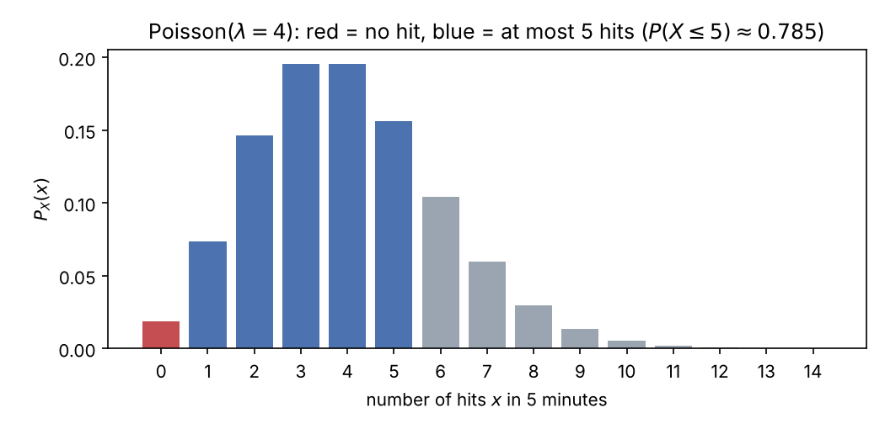

# Week 1 — Introduction and Probability Basics

Lecture: Lecture 1 — Introduction, plus the basics of Lecture 2 (handout §2.1–2.2) that Tutorial 1 needs. Problem sheet: Tutorial 1 (keep a local copy in [`../course-material/`](../course-material/); it is not published here).

## Files

| File | What it contains |
|---|---|
| [`01_Concepts.md`](01_Concepts.md) · [PDF](pdf/01_Concepts.pdf) | What SSP is (detection, estimation, time series), course outline, literature, exam rules; sample spaces and events, axioms, counting, conditional probability, independence, total probability and Bayes (lecture coin examples), discrete RVs, expectation/variance/moments, sums of independent RVs, Bernoulli/Binomial/Geometric/Poisson, series toolbox, recipes, cheat sheet |
| [`02_Solutions.md`](02_Solutions.md) · [PDF](pdf/02_Solutions.pdf) | Tutorial 1, Problems 1–5, fully worked |
| [`python/tutorial1_verify.py`](python/tutorial1_verify.py) | Exact Bayes + Monte Carlo for Monty Hall, Poisson numbers, symbolic Poisson moments, Binomial by enumeration, channel-decoder formulas vs simulation; figures in [`python/figures/`](python/figures/) |

Run with `python python/tutorial1_verify.py` (needs `numpy scipy matplotlib sympy`).

## Progress

- [x] Lecture 1 concepts (+ probability basics)
- [x] Problem 1 — Monty Hall
- [x] Problem 2 — Poisson probabilities
- [x] Problem 3 — Poisson mean and variance
- [x] Problem 4 — Binomial derivation
- [x] Problem 5 — Channel decoder and retransmissions

## Key results

- **Monty Hall:** switch — $P(\text{win}) = 2/3$ vs $1/3$ for staying.
- **Poisson(4):** $P(X\ge1) = 1-e^{-4}\approx0.982$, $P(X\ge3) = 1-13e^{-4}\approx0.762$, $P(X\le5) = \frac{643}{15}e^{-4}\approx0.785$.
- **Poisson moments:** mean = variance = $\lambda$.
- **Binomial:** $\binom{n}{x}p^x(1-p)^{n-x}$ = (number of 0/1 sequences with $x$ ones) × (probability of each).
- **Decoder:** $q = 56p^3(1-p)^5$; $P(N_R = n_R) = q^{n_R}(1-q)$; $E\lbrace N_R\rbrace = q/(1-q)$.

