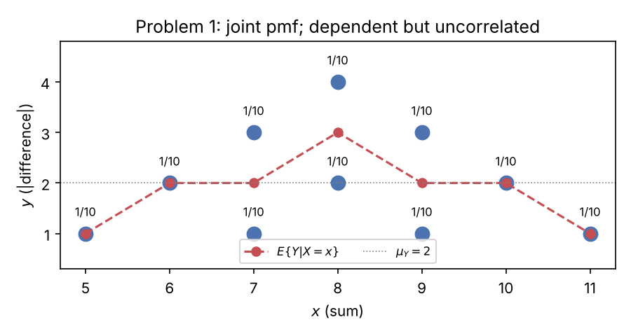
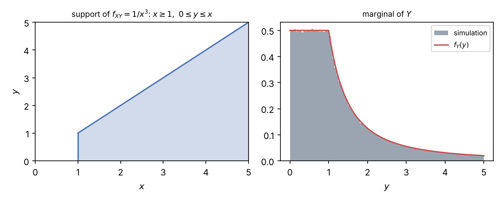
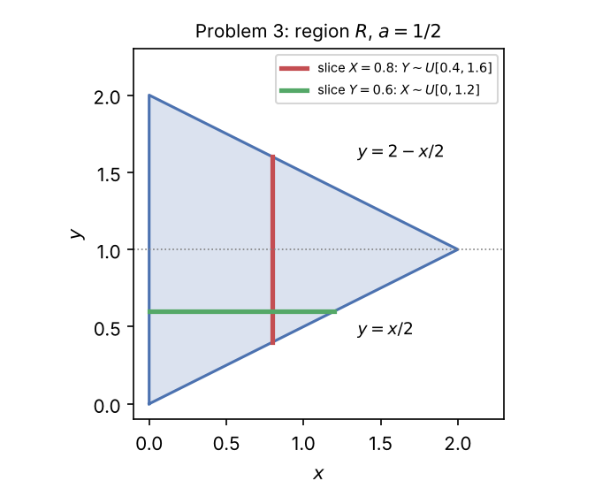

# Week 2 — Step-by-Step Solutions (Tutorial 2)

**Course:** Statistical Signal Processing (L.048.24014, Universität Paderborn, Dr.-Ing. Tanuj Hasija), WiSe 2026/27
**Covers:** Tutorial 2, Problems 1–3
**Checking:** no official solution was available when this was written. Every result is verified by [`python/tutorial2_verify.py`](python/tutorial2_verify.py) (exact fractions, symbolic integration with SymPy, Monte Carlo).

Every step is written out. References like "Concepts §9" point to [`01_Concepts.md`](01_Concepts.md).

---

## Contents

- [Problem 1 — Two discrete random variables (cards)](#problem-1--two-discrete-random-variables-cards)
- [Problem 2 — Bivariate pdf from a marginal and a conditional](#problem-2--bivariate-pdf-from-a-marginal-and-a-conditional)
- [Problem 3 — Uniform pdf on a triangle](#problem-3--uniform-pdf-on-a-triangle)
- [Summary of results](#summary-of-results)

---

## Problem 1 — Two discrete random variables (cards)

> A stack of 5 cards shows the numbers $2,\dots,6$. Pick 2 cards. $X$ = sum, $Y$ = absolute difference. Find the joint pmf, the marginals (independent?), the conditional pmf of $Y$ given $X$, the means, variances, covariance, correlation, correlation coefficient and $E\lbrace Y\mid X\rbrace$.

### Step 1 — Sample space

Two cards are drawn without replacement; the order does not matter for a sum or an absolute difference. So an outcome is an unordered pair $\lbrace a, b\rbrace\subset\lbrace2,\dots,6\rbrace$. There are $\binom{5}{2} = 10$ pairs, all equally likely, each with probability $\frac{1}{10}$ (Concepts Week 1 §4).

(Using ordered draws gives 20 outcomes, each pair appearing twice — same probabilities.)

### Step 2 — Compute $(X, Y)$ for every outcome

| pair $\lbrace a,b\rbrace$ | $x = a+b$ | $y = \lvert a-b\rvert$ | $xy$ |
|---|---|---|---|
| {2,3} | 5 | 1 | 5 |
| {2,4} | 6 | 2 | 12 |
| {2,5} | 7 | 3 | 21 |
| {2,6} | 8 | 4 | 32 |
| {3,4} | 7 | 1 | 7 |
| {3,5} | 8 | 2 | 16 |
| {3,6} | 9 | 3 | 27 |
| {4,5} | 9 | 1 | 9 |
| {4,6} | 10 | 2 | 20 |
| {5,6} | 11 | 1 | 11 |

All ten $(x,y)$ pairs are different, so each occurring pair has probability $\frac{1}{10}$.

### Step 3 — Joint pmf $P_{XY}(x,y)$ and marginals

Place $\frac{1}{10}$ in each occurring cell, then take row and column sums (Concepts §2.1):

| $P_{XY}(x,y)$ | $y=1$ | $y=2$ | $y=3$ | $y=4$ | $P_X(x)$ |
|---|---|---|---|---|---|
| $x=5$ | 1/10 | 0 | 0 | 0 | 1/10 |
| $x=6$ | 0 | 1/10 | 0 | 0 | 1/10 |
| $x=7$ | 1/10 | 0 | 1/10 | 0 | 2/10 |
| $x=8$ | 0 | 1/10 | 0 | 1/10 | 2/10 |
| $x=9$ | 1/10 | 0 | 1/10 | 0 | 2/10 |
| $x=10$ | 0 | 1/10 | 0 | 0 | 1/10 |
| $x=11$ | 1/10 | 0 | 0 | 0 | 1/10 |
| $P_Y(y)$ | 4/10 | 3/10 | 2/10 | 1/10 | 1 |

Marginals:
$$P_X(x) = \begin{cases}1/10, & x\in\lbrace5,6,10,11\rbrace\\ 2/10, & x\in\lbrace7,8,9\rbrace\end{cases},\qquad
P_Y(y) = \tfrac{5-y}{10},\quad y = 1,2,3,4.$$
Checks: $4\cdot\frac{1}{10} + 3\cdot\frac{2}{10} = 1$ and $\frac{4+3+2+1}{10} = 1$. ✓ ($P_Y$ makes sense: there are $5-d$ pairs of numbers in $\lbrace2,\dots,6\rbrace$ that differ by $d$.)

### Step 4 — Independence?

Take the cell $(x,y) = (5,2)$: $P_{XY}(5,2) = 0$, but $P_X(5)P_Y(2) = \frac{1}{10}\cdot\frac{3}{10} = \frac{3}{100}\ne0$. Hence
$$\boxed{X\text{ and }Y\text{ are not independent.}}$$
Intuition: knowing the sum restricts the difference. Sum and difference of two integers have the **same parity** ($a+b$ and $a-b$ differ by $2b$), so an odd sum forces an odd difference: $x$ odd ⇒ $y\in\lbrace1,3\rbrace$.

### Step 5 — Conditional pmf $P_{Y\mid X}(y\mid x) = P_{XY}(x,y)/P_X(x)$

Divide each row by its row sum:

- $x = 5$: $P_{Y\mid X}(1\mid5) = 1$
- $x = 6$: $P_{Y\mid X}(2\mid6) = 1$
- $x = 7$: $P_{Y\mid X}(1\mid7) = P_{Y\mid X}(3\mid7) = \frac12$
- $x = 8$: $P_{Y\mid X}(2\mid8) = P_{Y\mid X}(4\mid8) = \frac12$
- $x = 9$: $P_{Y\mid X}(1\mid9) = P_{Y\mid X}(3\mid9) = \frac12$
- $x = 10$: $P_{Y\mid X}(2\mid10) = 1$
- $x = 11$: $P_{Y\mid X}(1\mid11) = 1$

(all other $y$ have conditional probability 0). Each conditional pmf sums to 1. ✓ The conditionals differ from $P_Y$ — again showing dependence.

### Step 6 — Means

$$\mu_X = \sum_xxP_X(x) = \frac{5 + 6 + 2\cdot7 + 2\cdot8 + 2\cdot9 + 10 + 11}{10} = \frac{80}{10} = \boxed{8}$$
(Check by linearity: each card is a uniformly random element of $\lbrace2,\dots,6\rbrace$ with mean 4, so $E\lbrace X\rbrace = 4 + 4 = 8$.)
$$\mu_Y = \sum_yyP_Y(y) = \frac{1\cdot4 + 2\cdot3 + 3\cdot2 + 4\cdot1}{10} = \frac{20}{10} = \boxed{2}$$

### Step 7 — Variances

Second moments:
$$E\lbrace X^2\rbrace = \frac{25 + 36 + 2\cdot49 + 2\cdot64 + 2\cdot81 + 100 + 121}{10} = \frac{670}{10} = 67,$$
$$E\lbrace Y^2\rbrace = \frac{1\cdot4 + 4\cdot3 + 9\cdot2 + 16\cdot1}{10} = \frac{50}{10} = 5.$$
Shortcut $\sigma^2 = E\lbrace\cdot^2\rbrace - \mu^2$:
$$\boxed{\sigma_X^2 = 67 - 64 = 3},\qquad\boxed{\sigma_Y^2 = 5 - 4 = 1}$$

### Step 8 — Correlation $\mu_{XY} = E\lbrace XY\rbrace$

Sum the column $xy$ of the Step 2 table over the ten equally likely outcomes:
$$E\lbrace XY\rbrace = \frac{5+12+21+32+7+16+27+9+20+11}{10} = \frac{160}{10} = \boxed{16}$$

### Step 9 — Covariance and correlation coefficient

$$\sigma_{XY} = \mu_{XY} - \mu_X\mu_Y = 16 - 8\cdot2 = \boxed{0},\qquad
\rho_{XY} = \frac{\sigma_{XY}}{\sigma_X\sigma_Y} = \frac{0}{\sqrt3\cdot1} = \boxed{0}$$
$X$ and $Y$ are **uncorrelated but not independent** (Concepts §6).

**Why the covariance is exactly zero — a symmetry argument.** Replace every card $c$ by $8 - c$. This maps $\lbrace2,\dots,6\rbrace$ onto itself, so the distribution of the pair is unchanged. The sum becomes $16 - X$ and the absolute difference stays $Y$. Hence $(X,Y)$ and $(16 - X, Y)$ have the same joint distribution: the table is mirror-symmetric about $x = 8$. Then
$$\mathrm{cov}(X,Y) = \mathrm{cov}(16 - X, Y) = -\mathrm{cov}(X,Y)\;\Rightarrow\;\mathrm{cov}(X,Y) = 0.$$

### Step 10 — Conditional expectation $E\lbrace Y\mid X\rbrace$

From the conditional pmfs of Step 5, $E\lbrace Y\mid X = x\rbrace = \sum_yyP_{Y\mid X}(y\mid x)$:

| $x$ | 5 | 6 | 7 | 8 | 9 | 10 | 11 |
|---|---|---|---|---|---|---|---|
| $E\lbrace Y\mid X = x\rbrace$ | 1 | 2 | $\frac{1+3}{2} = 2$ | $\frac{2+4}{2} = 3$ | 2 | 2 | 1 |

So $E\lbrace Y\mid X\rbrace$ is the random variable that equals 1 when $X\in\lbrace5,11\rbrace$, 3 when $X = 8$, and 2 otherwise.

Check with the tower property (Concepts §5):
$$E\lbrace E\lbrace Y\mid X\rbrace\rbrace = \frac{1\cdot1 + 2\cdot1 + 2\cdot2 + 3\cdot2 + 2\cdot2 + 2\cdot1 + 1\cdot1}{10} = \frac{20}{10} = 2 = \mu_Y.\ ✓$$

### Step 11 — Interpretation

$E\lbrace Y\mid X = x\rbrace$ rises and falls (1, 2, 2, 3, 2, 2, 1): an extreme sum (5 or 11) forces neighbouring cards and thus a small difference, while a middle sum allows a large difference. This dependence is **symmetric, not linear**, so the best straight line through it is flat ($\rho = 0$, LMMSE $\hat Y = \mu_Y = 2$), even though $X$ carries real information about $Y$. Using the non-linear estimator $E\lbrace Y\mid X\rbrace$ instead reduces the error.

---

## Problem 2 — Bivariate pdf from a marginal and a conditional

> $f_X(x) = 1/x^2$ for $x\ge1$, 0 otherwise. Given $X = x$, $Y$ is uniform on $[0, x]$. (a) Joint pdf of $X$ and $Y$. (b) Marginal pdf of $Y$.

### Step 0 — Check that $f_X$ is a valid pdf

$f_X\ge0$ and $\int_1^\infty x^{-2}dx = \big[-x^{-1}\big]_1^\infty = 0 - (-1) = 1$. ✓ (Note: $E\lbrace X\rbrace = \int_1^\infty\frac{1}{x}dx = \infty$; the mean does not exist, but nothing below needs it.)

### Step 1 — Conditional pdf of $Y$ given $X = x$

"Uniform on $[0,x]$" means constant density $1/(\text{length}) = 1/x$ on that interval and zero outside (Concepts §7.2):
$$f_{Y\mid X}(y\mid x) = \begin{cases}\dfrac1x, & 0\le y\le x,\\[4pt] 0, & \text{otherwise,}\end{cases}\qquad x\ge1.$$

### Step 2 — (a) Joint pdf via the chain rule

$f_{XY}(x,y) = f_{Y\mid X}(y\mid x)\,f_X(x)$ (Concepts §8.3). It is non-zero only where **both** factors are non-zero: $x\ge1$ **and** $0\le y\le x$:
$$\boxed{f_{XY}(x,y) = \begin{cases}\dfrac1x\cdot\dfrac{1}{x^2} = \dfrac{1}{x^3}, & x\ge1,\ 0\le y\le x,\\[4pt] 0, & \text{otherwise.}\end{cases}}$$
**Support:** the region to the right of $x = 1$, between the x-axis and the line $y = x$ (left figure below). It is not a rectangle, so $X$ and $Y$ are dependent.

**Check normalisation** (integrate $y$ first along a vertical line, $0\le y\le x$):
$$\int_1^\infty\!\int_0^x\frac{1}{x^3}\,dy\,dx = \int_1^\infty\frac{x}{x^3}\,dx = \int_1^\infty\frac{1}{x^2}\,dx = 1.\ ✓$$

### Step 3 — (b) Marginal pdf of $Y$: find the $x$-range for each fixed $y$

$f_Y(y) = \int f_{XY}(x,y)\,dx$. Fix $y$ and draw a **horizontal** line at height $y$ through the support (Concepts §9). The joint pdf is non-zero where $x\ge1$ **and** $x\ge y$, i.e. $x\ge\max(1, y)$. The lower limit changes form at $y = 1$, so split:

- $y<0$: no point of the support ⇒ $f_Y(y) = 0$.
- $0\le y\le1$: $\max(1,y) = 1$ ⇒ $x$ runs over $[1,\infty)$:
$$f_Y(y) = \int_1^\infty\frac{dx}{x^3} = \Big[-\frac{1}{2x^2}\Big]_1^\infty = \frac12.$$
- $y>1$: $\max(1,y) = y$ ⇒ $x$ runs over $[y,\infty)$:
$$f_Y(y) = \int_y^\infty\frac{dx}{x^3} = \Big[-\frac{1}{2x^2}\Big]_y^\infty = \frac{1}{2y^2}.$$

$$\boxed{f_Y(y) = \begin{cases}0, & y<0,\\[2pt] \dfrac12, & 0\le y\le1,\\[6pt] \dfrac{1}{2y^2}, & y>1.\end{cases}}$$

### Step 4 — Checks

- **Normalisation:** $\int_0^1\frac12\,dy + \int_1^\infty\frac{1}{2y^2}\,dy = \frac12 + \frac12 = 1$. ✓
- **Continuity at $y = 1$:** both pieces give $\frac12$. ✓
- **Probabilities:** $P(Y\le1) = \frac12$ and $P(Y>2) = \int_2^\infty\frac{1}{2y^2}dy = \frac14$. A simulation (draw $X = 1/(1-U)$ by inverting $F_X(x) = 1 - 1/x$, then $Y = XV$ with $U, V$ uniform on $[0,1]$) gives 0.4999 and 0.2502. ✓
- **Intuition:** whatever $X$ is, the interval $[0,X]$ contains $[0,1]$, so small $y$ values are always possible — the flat part. Large $y$ needs a large $X$, which is rare — the $1/y^2$ tail.

### Bonus — conditional pdf of $X$ given $Y = y$ (Bayes for densities)

$$f_{X\mid Y}(x\mid y) = \frac{f_{XY}(x,y)}{f_Y(y)} = \begin{cases}\dfrac{2}{x^3}, & x\ge1\quad(\text{if }0\le y\le1),\\[6pt] \dfrac{2y^2}{x^3}, & x\ge y\quad(\text{if }y>1).\end{cases}$$
Observing $Y = y>1$ tells us $X\ge y$, and the density is renormalised on that range.

---

## Problem 3 — Uniform pdf on a triangle

> $f_{XY}(x,y) = a$ on the region $R$ (triangle with vertices $(0,0)$, $(0,2)$, $(2,1)$), 0 elsewhere. Find (a) $a$, (b) $f_{X\mid Y}(x\mid y)$ and $f_{Y\mid X}(y\mid x)$, (c) $\rho_{XY}$.

### Step 1 — Describe the region

From the figure, $R$ is the triangle with vertices $(0,0)$, $(0,2)$ and $(2,1)$. Its three edges:

- left edge: $x = 0$, from $(0,0)$ to $(0,2)$;
- lower edge: through $(0,0)$ and $(2,1)$, slope $\frac12$: $y = \frac{x}{2}$;
- upper edge: through $(0,2)$ and $(2,1)$, slope $-\frac12$: $y = 2 - \frac{x}{2}$.

So
$$R = \Big\lbrace(x,y): 0\le x\le2,\ \tfrac{x}{2}\le y\le2 - \tfrac{x}{2}\Big\rbrace.$$
Equivalently, solving the edge equations for $x$: $y = x/2\Leftrightarrow x = 2y$ and $y = 2 - x/2\Leftrightarrow x = 4 - 2y$. A horizontal line at height $y$ enters at $x = 0$ and leaves through the lower edge if $y\le1$, through the upper edge if $y\ge1$:
$$R = \lbrace0\le y\le1,\ 0\le x\le2y\rbrace\cup\lbrace1\le y\le2,\ 0\le x\le4-2y\rbrace.$$
**The region is symmetric about the line $y = 1$.**

### Step 2 — (a) The constant $a$

Normalisation: $\iint_Ra\,dx\,dy = a\cdot\text{area}(R) = 1$. The triangle has base 2 (the left edge, on the y-axis) and height 2 (distance from the y-axis to the vertex $(2,1)$), so area $= \frac12\cdot2\cdot2 = 2$. By integration: $\int_0^2\big[(2 - \frac x2) - \frac x2\big]dx = \int_0^2(2 - x)\,dx = 4 - 2 = 2$. ✓
$$\boxed{a = \frac12}$$

### Step 3 — Marginal pdfs (needed for the conditionals)

$f_X(x)$ = $a$ × (length of the vertical slice at $x$) = $\frac12\big[(2 - \frac x2) - \frac x2\big]$:
$$f_X(x) = 1 - \frac{x}{2},\qquad 0\le x\le2\quad(0\text{ otherwise}).$$
$f_Y(y)$ = $a$ × (length of the horizontal slice at $y$):
$$f_Y(y) = \begin{cases}\frac12\cdot2y = y, & 0\le y\le1,\\[2pt] \frac12(4 - 2y) = 2 - y, & 1\le y\le2,\\[2pt] 0, & \text{otherwise}\end{cases}\quad = 1 - \lvert y - 1\rvert\ \text{ on }[0,2].$$
Checks: $\int_0^2(1 - \frac x2)\,dx = 2 - 1 = 1$ ✓; $f_Y$ is a triangle of base 2 and height 1, area 1 ✓.

### Step 4 — (b) Conditional pdfs

Divide the joint pdf by the marginal on each slice (Concepts §8.2: uniform joint ⇒ uniform conditionals).

**$Y$ given $X = x$** ($0\le x<2$):
$$\boxed{f_{Y\mid X}(y\mid x) = \frac{f_{XY}(x,y)}{f_X(x)} = \frac{1/2}{1 - x/2} = \frac{1}{2-x},\qquad \frac x2\le y\le2 - \frac x2\quad(0\text{ otherwise})}$$
i.e. $Y\mid X = x\sim U\big[\frac x2,\ 2 - \frac x2\big]$, an interval of length $2 - x$ centred at $y = 1$. Check: $\frac{1}{2-x}\cdot(2 - x) = 1$ ✓.

**$X$ given $Y = y$** ($0<y<2$):
$$\boxed{f_{X\mid Y}(x\mid y) = \frac{1/2}{f_Y(y)} = \begin{cases}\dfrac{1}{2y}, & 0\le x\le2y,\quad\text{if }0<y\le1,\\[8pt] \dfrac{1}{2(2-y)}, & 0\le x\le4 - 2y,\quad\text{if }1\le y<2,\end{cases}\quad(0\text{ otherwise})}$$
i.e. $X\mid Y = y\sim U\big[0,\ 2\min(y, 2-y)\big]$. Both cases agree at $y = 1$ (density $\frac12$ on $[0,2]$). The conditionals are undefined where the marginal is zero ($x = 2$, $y\in\lbrace0,2\rbrace$), which are single points with probability 0.

**Example slices** (red and green in the figure): given $X = 0.8$, $Y\sim U[0.4, 1.6]$; given $Y = 0.6$, $X\sim U[0, 1.2]$.

### Step 5 — (c) Means

$$\mu_X = \int_0^2x\Big(1 - \frac x2\Big)dx = \Big[\frac{x^2}{2} - \frac{x^3}{6}\Big]_0^2 = 2 - \frac43 = \frac23.$$
(Centroid check: $\frac{0+0+2}{3} = \frac23$ ✓.) By the symmetry about $y = 1$: $\mu_Y = 1$ (centroid $\frac{0+2+1}{3} = 1$ ✓).

### Step 6 — (c) Second moments and variances

$$E\lbrace X^2\rbrace = \int_0^2x^2\Big(1 - \frac x2\Big)dx = \Big[\frac{x^3}{3} - \frac{x^4}{8}\Big]_0^2 = \frac83 - 2 = \frac23,\qquad
\sigma_X^2 = \frac23 - \frac49 = \frac29.$$
$$E\lbrace Y^2\rbrace = \int_0^1y^2\cdot y\,dy + \int_1^2y^2(2-y)\,dy = \frac14 + \Big[\frac{2y^3}{3} - \frac{y^4}{4}\Big]_1^2,$$
$$E\lbrace Y^2\rbrace = \frac14 + \Big(\frac{16}{3} - 4\Big) - \Big(\frac23 - \frac14\Big) = \frac76,$$
$$\sigma_Y^2 = \frac76 - 1 = \frac16.$$
So $\sigma_X = \frac{\sqrt2}{3}$ and $\sigma_Y = \frac{1}{\sqrt6}$, both non-zero.

### Step 7 — (c) Correlation and covariance

Integrate $y$ first over the vertical slice:
$$E\lbrace XY\rbrace = \int_0^2x\cdot\frac12\int_{x/2}^{2-x/2}y\,dy\,dx.$$
Inner integral: $\Big[\frac{y^2}{2}\Big]_{x/2}^{2-x/2} = \frac12\Big[\big(2 - \tfrac x2\big)^2 - \big(\tfrac x2\big)^2\Big] = \frac12\big(4 - 2x\big) = 2 - x$ (difference of squares). Then
$$E\lbrace XY\rbrace = \int_0^2\frac x2(2 - x)\,dx = \int_0^2\Big(x - \frac{x^2}{2}\Big)dx = 2 - \frac43 = \frac23.$$
$$\sigma_{XY} = E\lbrace XY\rbrace - \mu_X\mu_Y = \frac23 - \frac23\cdot1 = 0.$$

**Faster route (Concepts §5):** $Y\mid X = x$ is uniform on an interval centred at 1, so $E\lbrace Y\mid X = x\rbrace = 1$ for every $x$. A constant conditional mean implies $E\lbrace XY\rbrace = E\lbrace X\cdot1\rbrace = \mu_X$ and $\mu_Y = 1$, hence $\sigma_{XY} = 0$ immediately.

### Step 8 — (c) Correlation coefficient

$$\boxed{\rho_{XY} = \frac{\sigma_{XY}}{\sigma_X\sigma_Y} = \frac{0}{\frac{\sqrt2}{3}\cdot\frac{1}{\sqrt6}} = 0}$$

### Step 9 — Interpretation

$X$ and $Y$ are **uncorrelated but dependent**: the support is a triangle, not a rectangle, and the conditional pdf of $Y$ changes with $x$ (its range shrinks from $[0,2]$ at $x = 0$ to the single point $y = 1$ as $x\to2$). Knowing $X$ changes the **spread** of $Y$ ($\mathrm{var}(Y\mid X = x) = \frac{(2-x)^2}{12}$) but not its **centre**, and covariance only measures a linear trend in the centre. The best linear predictor of $Y$ from $X$ is the constant $\hat Y = 1$.

---

## Summary of results

| Problem | Result |
|---|---|
| 1 joint pmf | $P_{XY} = \frac{1}{10}$ on the 10 pairs listed in Step 2 |
| 1 marginals | $P_X(x) = \frac{1}{10}$ for $x\in\lbrace5,6,10,11\rbrace$, $\frac{2}{10}$ for $x\in\lbrace7,8,9\rbrace$; $P_Y(y) = \frac{5-y}{10}$; **not independent** |
| 1 moments | $\mu_X = 8$, $\mu_Y = 2$, $\sigma_X^2 = 3$, $\sigma_Y^2 = 1$, $E\lbrace XY\rbrace = 16$, $\sigma_{XY} = 0$, $\rho_{XY} = 0$ |
| 1 $E\lbrace Y\mid X\rbrace$ | $1, 2, 2, 3, 2, 2, 1$ for $x = 5,\dots,11$ |
| 2a | $f_{XY}(x,y) = 1/x^3$ for $x\ge1$, $0\le y\le x$ |
| 2b | $f_Y(y) = \frac12$ on $[0,1]$, $\frac{1}{2y^2}$ for $y>1$ |
| 3a | $a = \frac12$ |
| 3b | $f_{Y\mid X} = \frac{1}{2-x}$ on $[\frac x2, 2-\frac x2]$; $f_{X\mid Y} = \frac{1}{2y}$ on $[0,2y]$ ($y\le1$), $\frac{1}{2(2-y)}$ on $[0,4-2y]$ ($y\ge1$) |
| 3c | $\mu_X = \frac23$, $\mu_Y = 1$, $\sigma_X^2 = \frac29$, $\sigma_Y^2 = \frac16$, $\sigma_{XY} = 0$, $\rho_{XY} = 0$ |
